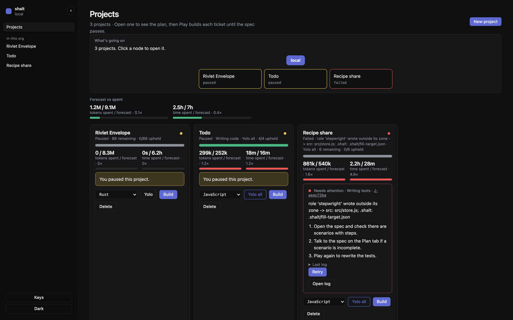
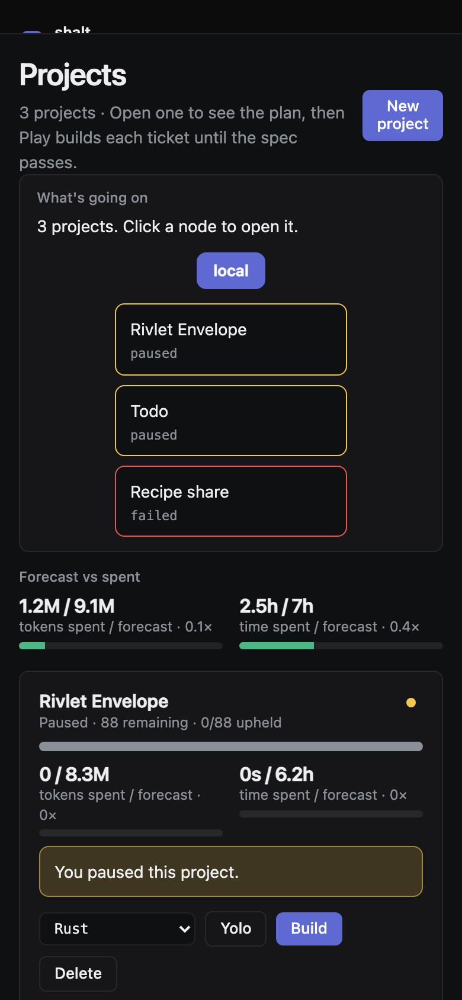
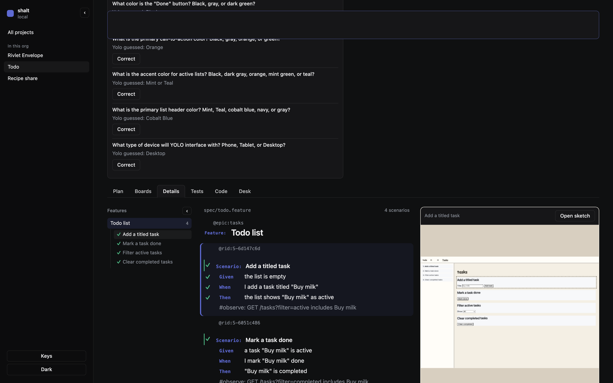
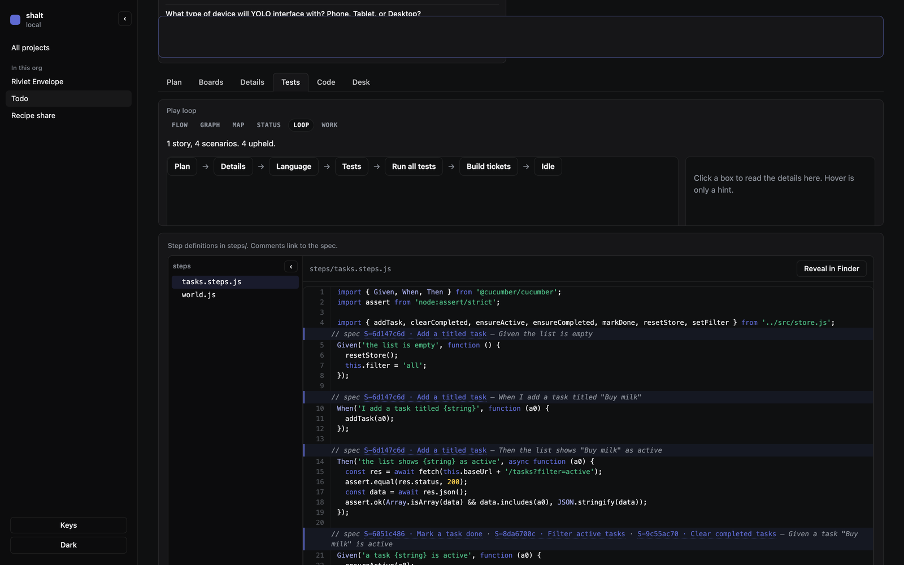
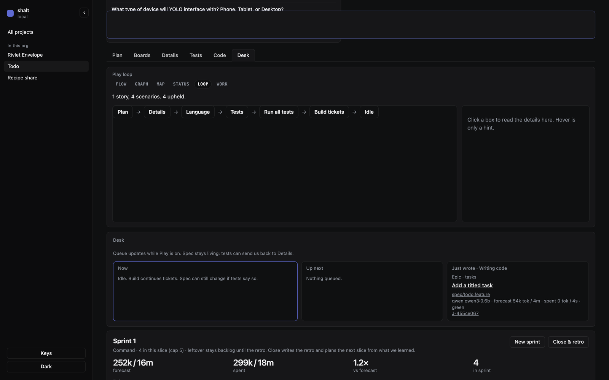
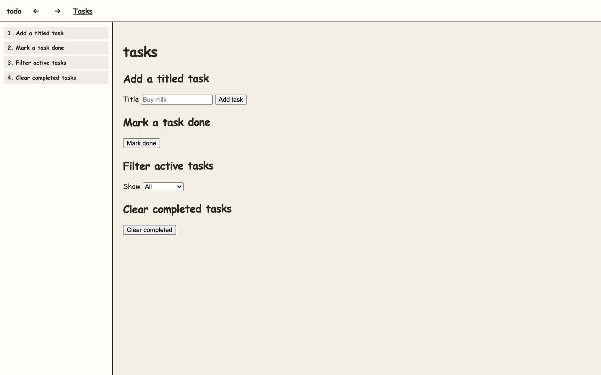
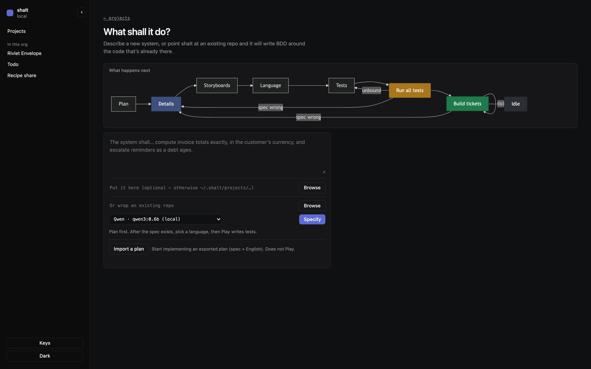
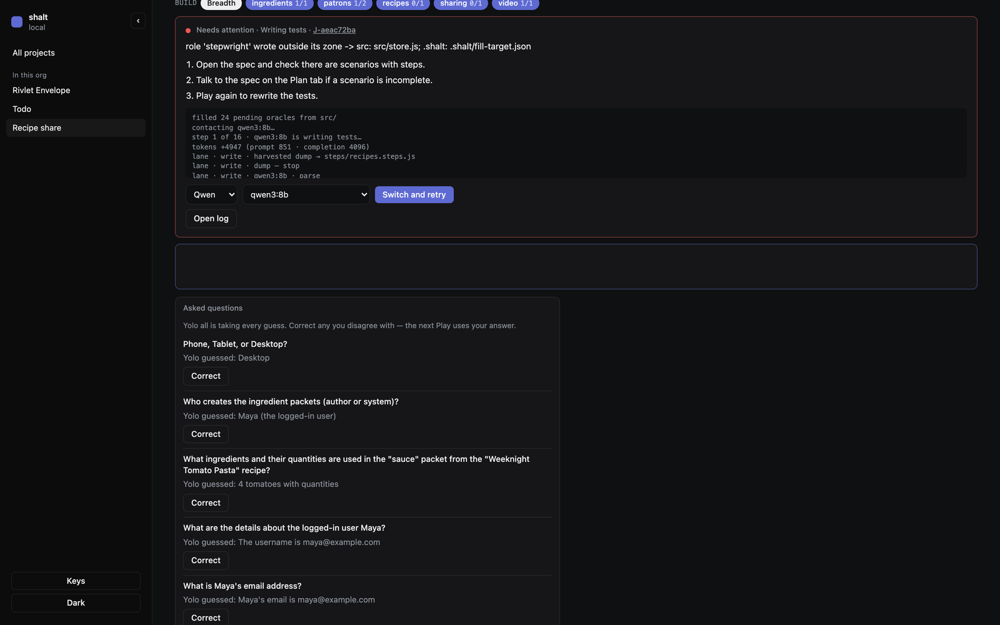

# Shalt

English in. Spec, tests, and a running app out.

**Green** is a bound test that passed against the current wording of a scenario — not an agent agreeing with itself. After every Then the spec names a **door** (`#observe:`). For the benches on this page that door is HTTP: `GET /tasks`, `GET /r/{id}`. A Then that asks the in-memory store is not that door.

Play writes the tests and the code in **zones**. The test writer cannot see `src/`. The implementer cannot see the step files. Isolation is the filesystem, not a prompt.

Yolo all takes guesses so Play does not sit on every colour question. Correct is for the **answer**, not a rephrased question. One project Plays at a time.

[MIT](LICENSE) · [github.com/danbgray/shalt](https://github.com/danbgray/shalt) · **[Manual](docs/manual.md)** · [limitations](docs/limitations.md)

Local writers below: Ollama Qwen. Grok/OpenAI/Anthropic exist in the binary; they did not write these benches.

## What it looks like



*Inbox. Todo parked **4/4**. Recipe share **failed** — `qwen3:8b` stepwright wrote `src/store.js` (outside `steps/`). Isolation held. Envelope paused on purpose.*



*Same catalog, narrow.*



*Todo Details. Four greens. `#observe: GET /tasks?filter=active includes Buy milk`. The sketch pane is the journey. Review is the sentences **plus** the Then bodies.*



*`steps/tasks.steps.js`. The Then is `fetch(this.baseUrl + '/tasks?filter=active')` — cucumber starts `src/server.js`. Given/When still call the store; the door is the GET.*



*Play loop: Plan → Details → Language → Tests → Run → Build → Idle. Last job **`qwen3:0.6b`**, green. 4 upheld.*



*Journey screen (sketch kit, spec rids). Not a gold UI. The tests do not grade how it looks.*



*`What shall it do?` Specify writes the spec. Play is later. Dropdown here is **`qwen3:0.6b`**, the bottom of the write lane — not a promise.*



*Recipe share after 8b dumped outside its zone. Yolo already took Desktop and a pile of guesses. Ingredients 1/1 on the bar is not 6/6 HTTP greens.*

## The idea

An agent that writes the spec, the tests, and the implementation can always go green. That is self-graded homework.

Shalt splits the work so those shortcuts fail in the tree:

| Failure | What it looks like | Defence |
|---|---|---|
| Tampering | Implementer edits the tests | Zones + write guard |
| Overfitting | Implementer special-cases the examples it saw | `@holdout` scenarios |
| Weak oracle | Then title is fine; the body does the When or `assert.ok(this.…)` | `#observe:` locked before Play; Then-body lint; HTTP GET when the observe says GET |
| Drift | Spec moved; suite still green | Status bound to a canonical hash |

First suite colour is recorded. **Red then green** is evidence. Never-red is a suspicion — the tool filled both sides.

`#observe:` is a spec comment (not a markdown heading). Cucumber ignores it. Play refuses a Then without it. Changing Then or observe after Play is an amendment.

A human reading **only the sentences** is taking the spec's word. Details shows the Then bodies. `shalt verify` flags a Then that acts instead of observing, or that ignores an HTTP observe.

## This run — 26–27 Sep 2026, local Ollama

Write lane Play hops:

`qwen3:0.6b` → `qwen3:1.7b` → `qwen3.5:2b-mlx` → `qwen3:4b` → `qwen3:8b`

Author and tests skip flash when they can. A dump hops up. 0.6b still shows up as keep-alive and as the last Todo build job.

No Grok. No Claude. Plan tiles for `qwen3.8:27b-mlx` / `claude-sonnet-4-5` with **0 tokens** did not write.

### Todo — 4/4, red then green, GET /tasks

Interview: add a titled task, mark done, filter, clear. Session only. JavaScript. Yolo all.

| Stage | Model | What landed |
|---|---|---|
| Author | (seed) | 2b–8b dump on older runs. This run: spec **seeded from the interview**, `#observe:` is GET `/tasks`. |
| Design | `qwen3.5:2b-mlx` | Sketch journey. Dumps get replaced with spec-rid fragments. |
| Tests | `qwen3:0.6b` | Writer skipped once oracles bound. Thens are `fetch`. |
| Run | cucumber-js | First colour **red** (404 server). Then **green** after Build. |
| Build | `qwen3:0.6b` | Fills `src/store.js` + `src/server.js` (`GET /tasks`, sqlite `.shalt/app.sqlite`). |

cucumber-js: 4 scenarios, 14 steps, pass. `never_red` count **0**.

### Recipe share — not there yet

Spec seeded (6 scenarios), including `unsigned GET of /r/weeknight-tomato-pasta`. Design drew. **`qwen3:8b` stepwright wrote `src/store.js`** and Play stopped. Isolation is doing its job; yolo-all has not reached `GET /r/{id}` on this run.

## How Play is supposed to work

Roles run in **stages**. Each stage only contains what that role may read.

| Zone | Writer | Readers |
|---|---|---|
| `spec/` | author | everyone |
| `mockups/` | designer | designer, implementer, human |
| `steps/` | stepwright | test runner |
| `contract/` | stepwright | implementer |
| `src/` | implementer | implementer, test runner |

The stepwright cannot see `src/`. The implementer cannot see step definitions. A write outside the zone is rejected and rolled back.

Play hops the write lane when a model dumps. A bigger model is not a better product. 8b still fails to author Feature/Scenario from a todo interview, and still walks out of `steps/`.

## Quick start

```bash
cargo test -p shalt-core --offline
cargo install --path crates/shalt --force
shalt --help
shalt ui
```

`shalt ui` is the same engine on `127.0.0.1` (default 7700, next free 7700–7799). One desk.

```bash
shall --yes total invoices exactly in the customer's currency
```

`shall <sentence>` is `shalt do`. `--yes` accepts every scenario. `examples/invoice/demo.sh` is the offline loop (no API key). `examples/rust-billing` is cucumber-rs.

```
shalt org yolo ID all    # take guesses — a setting, not a virtue
shalt org play ID
shalt org pause ID
```

One project Plays at a time. Pause the others.

## Spec

At Play, every scenario is stamped:

```
  @rid:S-6d147c6d
  Scenario: Add a titled task
    Given the list is empty
    When I add a task titled "Buy milk"
    Then the list shows "Buy milk" as active
    #observe: GET /tasks?filter=active includes Buy milk
```

Statuses: `pending` (no bound test — **never green**), `red`, `green` (bound pass against current hash), `stale` (was green; wording changed), `orphan` (gone from the spec).

## Language

The runner lives in `shalt.toml`. Init defaults to **Rust** (cucumber-rs). **JavaScript** (cucumber-js) is supported. Other stacks may run if they emit Cucumber JSON or Messages; those presets are not finished.

A scenario is green only if **every** step passed. Skipped, pending, undefined, and ambiguous are not passes.

## Commands

```
shall --model                 list models / pick a default
shall --model=qwen3.5:2b …    pin this model
shall <sentence>              spec, y/n each scenario, then tests
shall --yes <sentence>        accept every scenario, then tests
shalt init [--stack NAME]
shalt author "…"
shalt approve --yes --by you  re-lock hashes after you edit the spec
shalt steps / shalt build / shalt run
shalt status / shalt verify / shalt tree / shalt stories
shalt diagrams / shalt dashboard / shalt mutate
shalt play
shalt ui / shalt org / shalt board / shalt job
```

## Backends

| | |
|---|---|
| `--backend fixture --fixtures DIR` | recorded turns; tests and `demo.sh` |
| `--backend grok` | xAI; `XAI_API_KEY` |
| `--backend qwen` | Ollama `http://127.0.0.1:11434` |
| `--backend openai` | `OPENAI_API_KEY` |

`--model` and `--base-url` override. Tools are `list_files`, `read_file`, `write_file`, `done` — no shell. Paths resolve inside the stage; absolute paths and traversal are refused.

Keys live in the sidebar **Keys** panel → `~/.shalt/config.toml`. They are never printed. Env vars win if set.

## What this does not prove

See [limitations.md](docs/limitations.md). Feature/Scenario is a poor language for latency, cost, security, and how a UI feels. Holdouts and mutation **sample**. A Then that never went red is not evidence. Todo on this page **did** go red first. Recipe share has not reached `GET /r/{id}` yet.

## Layout

```
crates/shalt-core/        engine
crates/shalt/             CLI + desk HTML
crates/shalt-app/         optional macOS wrapper
examples/invoice/         offline fixture
examples/rust-billing/    cucumber-rs
examples/recipe-share/    Play snapshot: spec, sketch-kit wireframes, steps, store
docs/images/              desk + bench shots (models in the captions)
```

macOS: `./scripts/macos-install.sh` puts Shalt.app in Applications. Same desk.

## License

[MIT](LICENSE). Copyright 2026 Daniel Gray and contributors. The Feature/Scenario syntax is Gherkin; the runners are cucumber-family. Those are other people's work. This repo is the harness around them.
